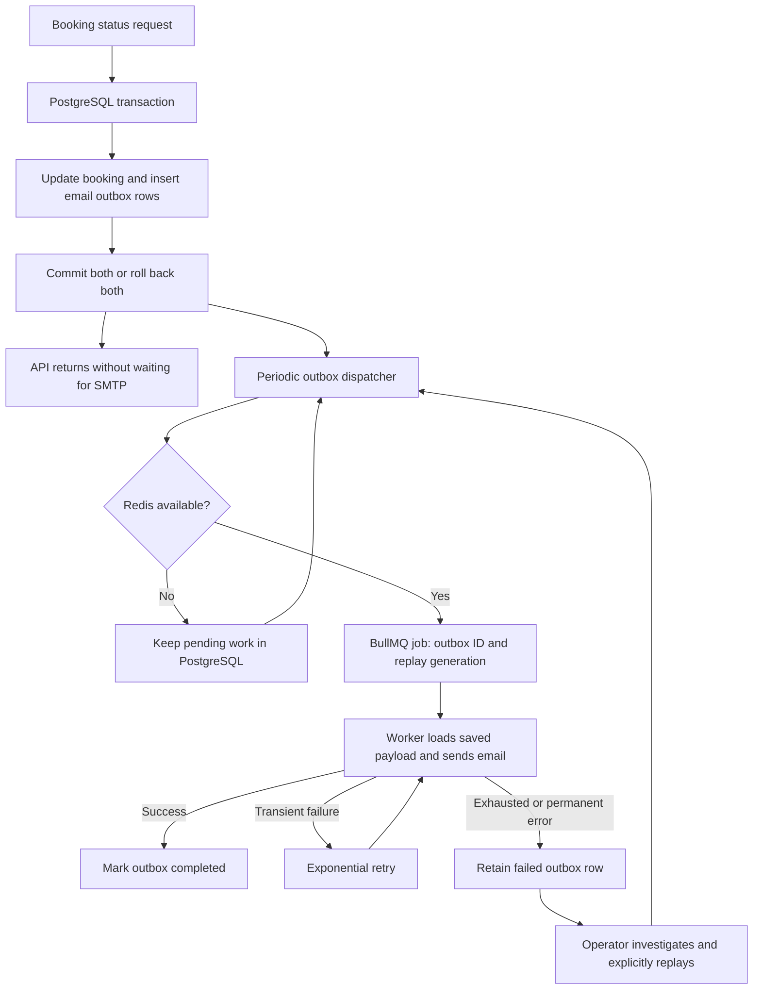

# Notification queue: implementation and interview guide

## Actual scope

Booking status changes made by `updateBookingStatus` save one `SEND_EMAIL` intent
per contact inside the same PostgreSQL transaction as the booking update. This
does not reroute payment callbacks, booking creation, chat or all in-app
notifications through the queue. The status-change in-app notification still uses
the existing direct path after commit. Both the dispatcher and BullMQ worker
currently run inside the API process; a separate worker service is not deployed.

## Flow



The default poll is one second. At most 25 outbox rows are claimed per pass using
`FOR UPDATE SKIP LOCKED` and a 30-second dispatch lease. Multiple API processes
can dispatch without claiming the same batch simultaneously. A lease expiring
after a crash makes undispatched work eligible again. This is a dispatch lease,
not a claim of exclusive email delivery after arbitrary worker failures.

The BullMQ job ID is stable for an outbox row and replay generation. A dispatcher
awaits Redis acceptance; if acceptance is uncertain, retrying uses the same ID.
The outbox remains the source of truth. Every 30 seconds, queued rows are checked
again: a missing Redis job is recreated, while completed/failed jobs are reconciled.
Redis dispatch failures do not consume the email delivery attempt budget.

Workers load payloads from PostgreSQL; Redis jobs contain references, not email
addresses or message bodies. Workers check the persisted completion state to
skip duplicate work after a recorded success. Worker concurrency defaults to 5
per process. The default delivery budget is 3 total attempts, with exponential
delays starting at 1 second (normally about 1 second, then 2 seconds). Invalid
jobs or missing handlers fail visibly. Handler errors propagate to retry logic.

## Failure recovery

Exhausted jobs remain `failed` in PostgreSQL until deliberately handled. BullMQ's
failed set is retained under its separate age/count cleanup policy, but cleanup
of Redis records does not delete the PostgreSQL failure record. This implements
durable failure retention and controlled replay without a separate Redis DLQ.

The CLI requires server database credentials and is not exposed as a public API:

```powershell
npm run notifications --prefix server -- list
npm run notifications --prefix server -- retry <outbox-uuid>
```

`list` returns at most 100 failures with IDs and attempt metadata, omitting email
addresses and message bodies. Inspect a specific row's `last_error` through an
authorized database session to diagnose it. Fix the cause before replaying.
Only failed rows can be replayed. Replay increments a generation and resets the
attempt budget; late updates from an older generation cannot change the new one.
The running API will dispatch the replayed intent on its next poll. Completed
jobs cannot be blindly replayed through this command.

`/health/ready` includes shared outbox counts and `oldestPendingSeconds`.
`waiting-for-redis` indicates deferred delivery, while database-backed intent
remains durable. `engine=bullmq` indicates configured transport, not verified SMTP
delivery. Prometheus job outcome counters remain available. A deployment still
needs alert rules for growing failures or old pending work; this change does not
configure an external paging service.

## Setup and upgrade

Apply the additive, idempotent schema migration before starting the updated API:

```powershell
npm run migrate:outbox --prefix server
```

The normal `npm run migrate --prefix server` also includes this schema. The
API checks the configured database before listening or starting its dispatcher.
It requires `public.notification_outbox` to resolve through the connection's
`search_path`, checks the columns the worker uses, and verifies SELECT, INSERT and
UPDATE privileges. If that check fails, the process exits nonzero with a safe
diagnostic; it does not run migrations or change schema during startup. A hosting
platform may restart the failed process until the configuration is corrected.
The check does not prove every constraint or index is correct.

Review the database target, migration permissions and backups before applying any
migration to an existing database. After an approved migration, restart the API.
Redis availability determines when dispatch can proceed. There is no in-memory
delivery fallback.

The new transport queue is `taskgenie-events-v2` because its payload format uses
outbox references. Before upgrading an existing deployment, stop new requests
to the old API and let its old `taskgenie-events` queue drain; inspect and resolve
any old failed jobs separately. This change does not automatically import legacy
Redis jobs. Roll back by stopping the new worker and keeping the additive outbox
table; old code will not drain new outbox work. Resume the new worker to recover
pending work. No application database or deployed queue was migrated by the
local test run.

Outbox rows include recipient addresses and email text. Restrict database access
and choose a retention policy. There is no automatic deletion of completed or
failed outbox rows in this version; archive/delete completed history according
to the deployment's policy, and resolve failed work before deleting it. PostgreSQL
backup/persistence configuration still matters.

## Delivery guarantees and limitations

- A committed booking status change has its associated email intent committed;
  a rolled-back change has neither. Database persistence is assumed.
- Redis downtime and application restarts do not intentionally discard committed
  outbox work. Dispatch resumes when the database, Redis and application recover.
- Processing uses bounded retries and can exhaust them; successful delivery is
  not guaranteed. Work is retained for inspection and explicit recovery.
- An SMTP server may accept an email immediately before the worker crashes or
  before recording completion. Retrying can send a duplicate. A stable SMTP
  Message-ID is used across automatic retries as an aid, not a deduplication
  guarantee. Exactly-once external delivery is not promised.
- A successful SMTP response is mail-server acceptance, not proof of inbox
  arrival or that a person read the message. The circuit-breaker timeout can also
  leave the result of an underlying SMTP operation uncertain.
- Jobs may execute out of order, including delayed replays of old status emails.
  Operators should check relevance before replay. Email failures do not reverse
  a committed booking change.

## Verification

The tests require explicit fixture URLs and never fall back to application
credentials for integration testing. Use an isolated PostgreSQL/PostGIS database
and Redis instance. SMTP is controlled in tests; no external mail is sent.

```powershell
$env:NODE_ENV='test'
$env:OUTBOX_TEST_DATABASE_URL='<disposable PostgreSQL connection string>'
$env:OUTBOX_TEST_REDIS_URL='<disposable Redis connection string>'
$env:BOOKING_TEST_DATABASE_URL=$env:OUTBOX_TEST_DATABASE_URL
node --test server/test/eventQueue.test.js server/test/health.test.js server/test/notificationOutbox.integration.test.js server/test/bookingIntegrity.integration.test.js
```

The integration checks cover rollback/commit with actual controllers, work
retained while Redis readiness is unavailable, a fresh worker draining saved
work, broken producer connection recovery, duplicate dispatch after lost Redis
acknowledgement, competing dispatchers, restoration of a removed Redis job,
real BullMQ retries, exhausted failure retention, explicit replay and stale
generation rejection. Readiness loss and lost acknowledgements are injected;
Redis server power loss and an OS-level worker kill are not exercised. Live SMTP,
external notification delivery, AWS and production throughput remain unverified.

Local verification on 2026-10-27: the full backend suite passed 189 tests with
zero failures and one skipped, opt-in provider-discovery check (which needs a
separately configured application dataset). That run included the outbox's
actual PostgreSQL/Redis integration suite and booking-controller transaction
tests. The focused unit and health checks were also run separately.

A subsequent focused run passed all 35 booking/outbox integration tests with no
skips. It includes an explicit commit-to-worker check: a separate DB connection
cannot see the uncommitted event; after commit it reads the persisted payload,
the dispatcher puts only its ID/generation into Redis, and an actual BullMQ
worker loads the PostgreSQL payload and records completion. The rollback test
also verifies that neither the booking change nor its intent survives rollback.

## How to explain it in an interview

> A booking status change can succeed even if an email service is temporarily
> unavailable. Originally I queued the email after committing the booking, which
> left a failure window if the process stopped between those steps. I changed
> that to a transactional outbox: the booking update and email intent commit in
> the same PostgreSQL transaction. A background dispatcher submits saved work to
> BullMQ, and workers send emails with bounded retries and exponential backoff.
> Redis downtime leaves work in PostgreSQL. Failed work is retained for inspection
> and explicit replay. Stable job IDs reduce duplicate queue submissions, but I
> don't claim exactly-once SMTP delivery because an email can be accepted before
> the worker records success.

Use this as a design explanation, not a story about a production incident. This
change followed a code review and local failure testing. Describe your own role
accurately and be able to walk through the code and trade-offs.
