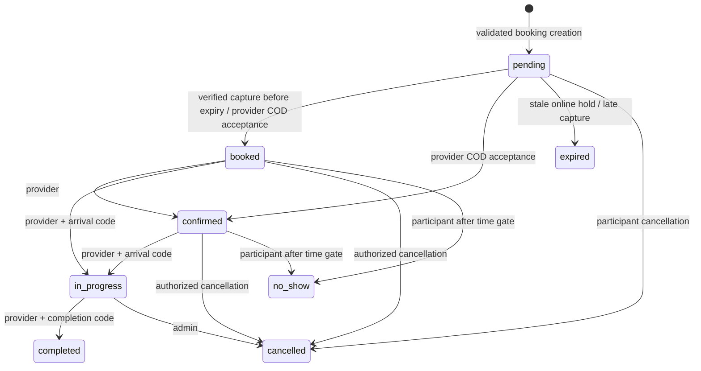

# Booking and payment transitions

Booking and payment are separate state machines. Payment capture is not evidence
that a service has started, and cancellation is not evidence a refund completed.
HTTP actors come from JWT authentication; transition handlers also check ownership.

| Actor | Permitted transitions | Additional gates |
| --- | --- | --- |
| Customer | pending/booked/confirmed -> cancelled; booked/confirmed -> no_show | Must own booking; no-show at least 20 minutes after start |
| Provider | pending -> booked/confirmed/cancelled; booked -> confirmed/in_progress/cancelled/no_show; confirmed -> in_progress/cancelled/no_show; in_progress -> completed | Must be assigned; service start not more than 15 minutes early; arrival/completion code; accepted online booking must be paid |
| Admin | pending/booked/confirmed/in_progress -> cancelled | Admin JWT role; refund policy still applies |
| Verified payment service | pending -> booked, or pending -> expired on late capture | Stored order/amount/INR/captured-state binding, schedule lock, unexpired hold and no conflicting reservation |
| Reconciler | pending unpaid online -> expired | Expired hold, no recorded capture |

Completed, cancelled, expired and no-show bookings cannot be revived through status
updates. The dedicated unpaid-release endpoint accepts pending/expired/cancelled
online intents without a recorded capture, sets cancelled and releases the hold;
this is terminal intent cleanup, not revival. Late capture retains the terminal
status, records the money, and requests a full refund.

Times use Asia/Kolkata. A provider cannot cancel an accepted booking within two
hours of start. Customer cancellation of an accepted paid booking within two hours
requests 80%; otherwise cancellation requests 100%. Customer-reported no-show
requests 100%; provider-reported no-show does not automatically refund. These are
current application policies, not universal payment-provider rules.

## Financial states

| Trigger | Financial transition |
| --- | --- |
| Create booking | pending |
| Verified capture | pending -> paid |
| Late capture / eligible paid cancellation | paid -> refund_pending with durable refund intent in same transaction |
| Provider completes COD service | pending -> paid |
| Gateway refund pending | refund_pending |
| Gateway refund failed | refund_failed; requires reconciliation/operator review |
| Gateway processed, partial amount | partially_refunded if no other intent remains outstanding |
| Gateway processed, full amount | refunded |

Failed payment-attempt webhooks do not overwrite captured payment or release a
valid hold. A previously recorded capture is returned unchanged on replay, even
if a later authoritative gateway fetch reports it refunded. The unique payment ID
and booking lock prevent a second capture from silently overwriting the first.

Refund intents: `pending -> submitting -> processing/processed/failed`; an ambiguous
submission becomes `unknown` when later receipt lookup finds no result. Discovery
of a matching gateway refund reconciles submitting/unknown. `processed` is terminal
in the synchronizer. Only pending may submit, using an atomic compare-and-set.

## Lock order

Creation: provider/day advisory lock -> schedule checks -> insert -> commit.
Mutations/finalization/refund sync: provider/day advisory lock -> booking row lock
-> financial/transition checks -> changes -> commit. Chat locks its booking row
before allocating a persisted message ID; it never acquires a schedule lock.
External refund I/O happens outside database transactions.

Use the tests in [ENGINEERING.md](ENGINEERING.md) to demonstrate these behaviors.
